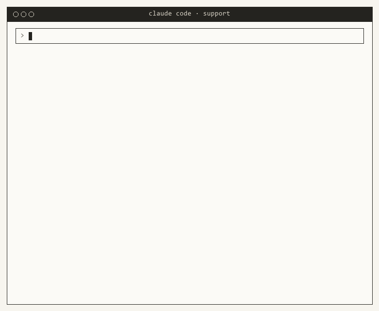
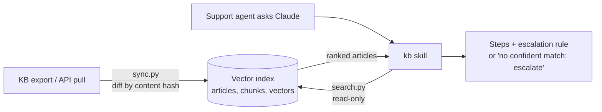

# KB Support Search Skill

**A Claude Code skill, `/kb`, that turns a support knowledge base into a search engine for troubleshooting. An agent types `/kb` and a question in plain words, and gets the right article's steps and when to escalate.**



*Agents never ran a script by hand. They typed `/kb` and a question in Claude Code, and the Python search ran under the hood. The session above is recreated from real output: every score and step comes from running the skill's search script on the sample knowledge base.*

| | |
|---|---|
| **Problem** | Support agents searched a large knowledge base by hand while customers waited. |
| **What I built** | A pipeline that keeps a vector index of the knowledge base in sync with HubSpot, plus a Claude skill that searches it and answers with the matching article's steps. |
| **Result** | Used daily by 12 full-time support agents. Finding an article by hand took about 20 seconds; with `/kb`, the answer arrives in about 3. |
| **Stack** | Python, vector search, HubSpot (CSV export, then API), cron, Claude Agent Skills |
| **My role** | Designed and built it end to end, including the sync pipeline and skill release process |

> **About this repo:** I built the original for the support team at a digital-signage company. This is a similar workflow built from scratch on fictional articles. It is not the company's code and contains none of its data.

---

## How the original worked

1. **Knowledge base → vector database.** At first, articles came out of HubSpot as a routine bulk CSV export. Once the HubSpot API was available, I replaced that with a **cron job that cross-referenced the HubSpot knowledge base for changes** and updated the internal vector database to match.
2. **Claude skill, run as `/kb`.** Agents typed `/kb` and a question in plain language. The skill searched the vector database and answered from the matching article.
3. **Release control.** I set up versioned releases for the skill so every agent automatically stayed on the latest version, with no manual reinstalling.

## What this demo shows

The same three ideas, small enough to run anywhere in seconds with Python alone (no API keys):

| Original | This repo |
|---|---|
| HubSpot export / API pull | `exports/*.csv`, two dated exports a month apart |
| Cron job that applies only what changed | `sync.py` compares content hashes and re-embeds only new or edited articles, deleting removed ones |
| Vector database | `kb_index.db`: SQLite holding chunks and their vectors |
| Embedding model | A built-in hashed n-gram embedder ([`kb.py`](.claude/skills/kb/scripts/kb.py)); swap `embed()` for a real model in production |
| Claude skill | [`.claude/skills/kb/`](.claude/skills/kb/SKILL.md), loaded automatically by Claude Code in this folder |



### Search

Hybrid ranking in [`kb.py`](.claude/skills/kb/scripts/kb.py):

1. **Exact error code first.** `E-620` in the question pins that article to the top (score 1.0). Error codes are where similarity search is weakest and exact matching is cheapest.
2. **Vector similarity.** Each article is split into an *overview* chunk (symptom language) and a *steps* chunk. The question is embedded and compared against every chunk, and each article takes its best chunk's score.
3. **Confidence floor.** Below 0.25 the skill reports "no confident match" and recommends escalation instead of guessing. "How do I bake a cake" scores 0.02.

Character trigrams in the embedder make it tolerant of typos: "screan is flickring" still finds *Screen flickers or shows lines*.

Search compares the question with every stored vector in plain Python: about 50 ms a query at 300 articles and 0.7 s at 3,000 on my machine. Past a few thousand articles, the next step is one numpy matrix product over all vectors, or a dedicated vector index.

### Incremental sync

```text
$ python sync.py exports/kb_export_2026-11-09.csv
  + Touchscreen not responding to taps
  ~ Black screen after a firmware update
  - Customer locked out of the content console
  1 added  1 updated  1 removed  8 unchanged
```

Each article's vector depends only on its own text, so unchanged articles are never re-embedded. Run it on a schedule against each new export or API pull:

```cron
0 * * * *  cd /path/to/repo && python sync.py exports/latest.csv >> sync.log 2>&1
```

Every run is also recorded in the index's `sync_log` table.

### Guardrails

- The skill can only **read**: `search.py` opens the index in SQLite read-only mode. Updating it is `sync.py`'s job.
- The skill answers **only from returned steps**, always cites the article number, and escalates rather than improvising when nothing matches.

## Run it

Python 3.10+, standard library only.

```bash
git clone https://github.com/vuln7/KBsearch
cd KBsearch
python sync.py exports/kb_export_2026-10-01.csv      # build the index
python sync.py exports/kb_export_2026-11-09.csv      # apply a month of changes
python search.py "screen went black after the update" --pretty   # the search script on its own
python -m unittest discover tests                    # 10 tests
```

With Claude, the way it is meant to be used: run `claude` (Claude Code) in this folder and type `/kb screen went black after the update`. The skill loads automatically.

## Repo layout

```text
.claude/skills/kb/
    SKILL.md              how Claude should search and answer
    scripts/kb.py         embedder, vector store, sync, hybrid search
    scripts/search.py     search CLI (JSON for Claude, --pretty for people)
    scripts/pretty.py     terminal styling
sync.py                   apply a KB export to the index
search.py                 shortcut to the skill's search CLI
exports/                  two fictional KB exports, a month apart
tests/test_kb.py          sync and search tests
docs/make_demo_gif.py     renders docs/demo.gif, a /kb session, from real search output
```

## What I learned

Building this taught me how to create workflows and pipelines in HubSpot, how to automate HubSpot in general, and how to automate processes the company depends on every day.

## What I'd do next

- **Answer feedback:** let agents flag wrong or outdated answers, and feed those back to whoever owns the article.
- **Gap report:** log questions with no confident match, to show which articles the knowledge base is missing.
- **Accuracy tracking:** a fixed set of real past tickets, re-run after every sync, so changes to the index or embedding model can't silently make search worse.
